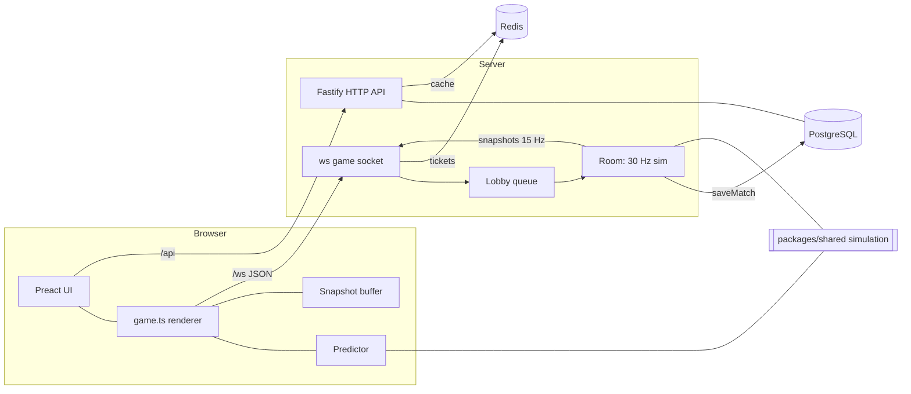
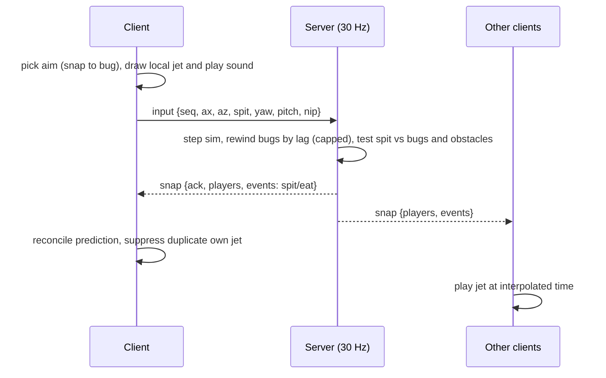

# Spitfin

A real-time multiplayer browser game. Two to four fish share a pond, spit down flying bugs, eat them as they float, and nip each other's stash. Matches last 150 seconds. The server is authoritative, the client is a thin predictive renderer, and the whole simulation is deterministic and shared between both sides.

- Genre: arcade, 2-4 players, 150 s matches
- Stack: TypeScript monorepo (pnpm), Node 22, Fastify, `ws`, PostgreSQL, Redis, Vite, Three.js, Preact
- Rendering: orthographic 3D, flat-shaded code-built models, custom water shader, no asset files

---

## Status legend

Used throughout this document so nothing is overstated.

| Mark | Meaning |
| --- | --- |
| ✅ | Implemented and confirmed (typecheck, tests, and a browser check passed) |
| 🟡 | Written, but not yet confirmed (no pasted typecheck/test/browser result) |
| ⏳ | Planned, not written |

Last confirmed test run: **138 shared + 58 client + 227 server = 423 tests**, typecheck clean.

| Area | Status |
| --- | --- |
| Deterministic shared simulation | ✅ |
| Authoritative server, lobby, rooms, matchmaking queue | ✅ |
| Client net layer, snapshot interpolation, own-fish prediction | ✅ |
| Accounts, sessions, WebSocket tickets | ✅ |
| Match persistence, ratings, aggregates, leaderboard, stats dashboard | ✅ |
| Fish and bug models, pond-edge foreground, water shader, ripples, swim animation | ✅ |
| Synthesized audio (`audio.ts`, rate limiting, game hooks) | 🟡 |
| Security headers hook and tests | ⏳ (written earlier, never applied) |
| End card awards, settings panel, particles, squash and stretch, touch controls | ⏳ |
| Quality tiers, bug instancing, perf overlay, CSP, per-IP limits, binary snapshots | ⏳ |

---

## Table of contents

1. [How the game plays](#how-the-game-plays)
2. [Controls](#controls)
3. [Quick start](#quick-start)
4. [Playing on a LAN](#playing-on-a-lan)
5. [Repository layout](#repository-layout)
6. [Architecture](#architecture)
7. [Network protocol](#network-protocol)
8. [Client](#client)
9. [Server](#server)
10. [Security](#security)
11. [Optimization](#optimization)
12. [Testing](#testing)
13. [Configuration](#configuration)
14. [Deployment notes](#deployment-notes)
15. [Known limitations](#known-limitations)
16. [Roadmap](#roadmap)
17. [Engineering rules](#engineering-rules)

---

## How the game plays

**Match flow**

1. Sign in, press **Find match**. You enter a queue (`queued {waiting}`).
2. When 2 to 4 players are waiting, a room starts. Everyone receives the same seed.
3. The match runs for **150 seconds**.
4. The server sends a ranking. You can **Play again** or go **Back to lobby**.

**Core loop**

- Bugs fly over the pond on deterministic paths.
- **Spit** a jet of water at a bug. A hit knocks it down; it falls and floats on the water.
- **Eat** floating bugs to build your **stash** and **eaten** count.
- **Nip** another fish to steal from them. A nip triggers a short **dash** and has a cooldown. Nip events record the thief and the victim (or nobody when it misses).
- **Reeds and rocks** are obstacles. They block movement and can block a spit (`blockedBy`).
- The ranking reports each player's rank, stash, eaten count and nips.

The exact scoring rules live in `packages/shared`. That package is the single source of truth for gameplay.

**Gameplay constants**

| Constant | Value |
| --- | --- |
| Players per match | 2 to 4 |
| Match duration | 150 s |
| Simulation rate | 30 Hz |
| Snapshot rate | 15 Hz |
| Arena | x in [-12, 12], z in [-8, 8], water surface y = 0 |
| Spit range | 8 units |
| Spit cooldown | 0.7 s |
| Nip cooldown | 3 s |
| Dash duration | 0.25 s |

---

## Controls

| Input | Action |
| --- | --- |
| `W` `A` `S` `D` | Swim (screen-relative, mapped through the 45 degree camera yaw) |
| Mouse | Aim; the cursor snaps to a bug within 56 px |
| Left click (hold to repeat) | Spit |
| `Space` | Nip |

Touch controls (joystick, tap to spit, nip button) are planned.

---

## Quick start

Requirements: Node 22, pnpm, Docker (for PostgreSQL and Redis).

```bash
git clone git@github.com:kaif006/spitfin.git
cd spitfin
pnpm install

# PostgreSQL and Redis
docker compose up -d

# Terminal 1: server (port 8080, runs migrations on start)
pnpm --filter @spitfin/server dev

# Terminal 2: client (port 5173, proxies /api and /ws to the server)
pnpm --filter @spitfin/client dev
```

Open `http://localhost:5173`. To test multiplayer alone, open two browser profiles (a session cannot be in two matches at once).

Useful commands:

```bash
pnpm typecheck        # all packages
pnpm test             # all packages
pnpm --filter @spitfin/client build
```

---

## Playing on a LAN

The server already binds `0.0.0.0`, and `COOKIE_SECURE` defaults to `false` outside production, so plain HTTP works on a local network. The client dev server needs `server.host: true` in `apps/client/vite.config.ts`.

1. Start Docker, the server and the client as above.
2. Find your LAN address: `hostname -I`.
3. Other devices on the same network open `http://<your-lan-ip>:5173`.

If the page does not load, check the firewall (`sudo ufw status`) and whether the router isolates wireless clients. Some browser APIs are unavailable on non-localhost plain HTTP.

---

## Repository layout

```
spitfin/
  docker-compose.yml        PostgreSQL + Redis for local development
  packages/
    shared/                 Pure deterministic simulation, protocol types, codec
  apps/
    server/                 Fastify HTTP API + ws game sockets + rooms + persistence
    client/                 Vite + Three.js renderer + Preact UI
```

**`packages/shared`**

- The simulation (movement, spit, nip, eating, scoring, bugs, obstacles), shared by server and client.
- `protocol.ts`: message and event types. `codec.ts`: validation and decoding of wire messages.
- No I/O, no clocks, no randomness beyond the seed. Everything is deterministic.

**`apps/server/src`**

- `index.ts` composition root; `config.ts` environment parsing; `app.ts` Fastify app and health checks.
- `ws.ts` WebSocket attach and message handling.
- `rooms/lobby.ts` queue and matchmaking; `rooms/room.ts` one running match.
- `db/` pool, users, migrations; `stats/` match record building and saving.
- `redis.ts` Redis client.

**`apps/client/src`**

- `game.ts` the renderer, input, prediction wiring and HUD (starts itself after sign-in).
- `net/` network client, match store, snapshot buffer, predictor.
- `Picking.ts` cursor aiming; `models.ts` geometry; `water.ts`, `ripples.ts`, `foreground.ts`, `foregroundLayout.ts` visuals.
- `audio.ts`, `audioLogic.ts` sound.
- `auth/`, `stats/`, `ui/` sign-in, dashboard, lobby panel, end card.

---

## Architecture



**Principles**

1. **Server authoritative.** The client sends intent (axes, spit aim, nip), never positions or hit claims.
2. **One simulation, two consumers.** The same pure code in `packages/shared` runs on the server (truth) and the client (prediction and presentation).
3. **Determinism from a seed.** Obstacles and every bug's spawn and flight path derive from the match seed (`generateObstacles`, `makeBugSpec`, `makeFallingBug`). Bugs and obstacles are never sent over the wire.
4. **Events, not state, for discrete things.** Spit, nip and eat are small tick-stamped events inside snapshots.
5. **Time-aligned presentation.** The client renders other players slightly in the past (interpolation) and aims at the time the server will test a shot.

**Spit lifecycle**



**Tick model**

- Server simulates at 30 Hz and broadcasts snapshots at 15 Hz.
- The client sends input at a fixed 30 Hz using an accumulator (capped at 0.1 s so a stalled tab cannot burst).
- Each input carries a sequence number; snapshots carry `ack`, the last processed input.

---

## Network protocol

Transport: WebSocket, JSON messages. (Binary snapshots are planned.)

**Client to server**

| Message | Payload |
| --- | --- |
| `ping` | none |
| `join` | none (enter the queue) |
| `leave` | none (leave the queue) |
| `input` | `{ seq, ax, az, spit, yaw, pitch, nip }` |

**Server to client**

| Message | Payload |
| --- | --- |
| `welcome` | session established |
| `pong` | reply to ping, used for RTT |
| `queued` | `{ waiting }` |
| `start` | `{ seed, you, players }` |
| `snap` | `{ tick, ack, players, events }` |
| `end` | `{ ranking }` |
| `error` | error code (for example `already_playing`) |

**`WirePlayer`**: `id, x, z, vx, vz, facing, stash, eaten, shots, hits, nips, spitCd, nipCd, dash, immune`

**`WireRank`** (today): `{ id, rank, stash, eaten, nips }`

**Events** (each carries `tick`)

| Event | Fields |
| --- | --- |
| `spit` | `playerId, length, hit: { bugId, x, y, z } or null, blockedBy or null` |
| `nip` | `thiefId, victimId or null` |
| `eat` | `playerId, bugId` |

A wire spit carries no yaw or pitch, so other players' misses are drawn along their facing direction.

Every inbound message is validated by `codec.ts` before it reaches the simulation.

---

## Client

### Rendering

- **Camera:** orthographic, 50 degree pitch, 45 degree yaw, fixed world-height frustum (the view never changes with FOV, only with window aspect).
- **Models:** built in code with flat shading and vertex colours (`models.ts`). The fish has a striped body, tail, dorsal and side fins plus eyes. Bugs have a flying form (dark, with wings) and a floating form (gold, no wings).
- **Swim animation:** a sine wave travels down the fish body in the vertex shader (`onBeforeCompile`, `uPhase` and `uAmp`). Phase and amplitude follow a speed-smoothed value per fish, so fish swim faster when they move faster.
- **Water:** one translucent full-pond layer with a fake sky reflection (Fresnel), a sun glint, ambient waves, ripple rings and three height samples per pixel for normals.
- **Ripples:** an 8-slot pool with 4 s life. Ripples appear where a shot bug lands and behind fast-moving fish.
- **Foreground:** a ring of leaves covering the pond border plus scattered leaves that avoid the arena and the bug flight volume. One `InstancedMesh` (at most 320 leaves) parented to the camera. Layout maths (`foregroundLayout.ts`) is pure and tested. Sway respects `prefers-reduced-motion`.
- **Spit jets:** a thin cylinder per player, drawn for 140 ms.
- **HUD:** a plain DOM element showing time, stash, eaten, hit/shot ratio, cooldowns, ping and a mini scoreboard.

### Netcode

- **Interpolation:** other fish and bugs are drawn about 2/15 s (two snapshot intervals) behind the newest snapshot. The render clock eases toward its target and snaps back if it drifts by more than 0.5 s.
- **Prediction:** only your own fish is predicted (`Predictor`). It steps the shared simulation locally, stores unacknowledged inputs, and on each snapshot replays them from the server's state (`reconcile`).
- **Error smoothing:** the visible correction decays exponentially (about 12 per second) instead of snapping. Corrections over 3 units snap immediately.
- **Aim time:** `bugClock` estimates the match time at which the server will evaluate a spit sent now (latest snapshot time plus age plus RTT plus a tick, minus the lag rewind). Bugs are aimed and picked at that time, so shots land where they look.
- **Local jet:** your own jet appears instantly on click. The matching server event is recognised and not drawn twice.

### Audio (🟡 written, unconfirmed)

- Pure Web Audio synthesis, no sound files. Effects: spit, hit, eat, nip, splash, end, UI click.
- The audio context is created and resumed on the first pointer or key event (browser autoplay rules).
- A per-sound rate limiter prevents stacking, and at most 12 voices play at once.
- Master volume is clamped to 0..1 and will be driven by the settings panel.
- Pure parts (rate limiter, volume clamp, envelope) are unit-tested; browser APIs are guarded so tests in Node do not crash.

### UI

- Preact 11 with strict typings.
- Sign-in page, pond/lobby panel (idle, connecting, queued, reconnecting, offline, end card), and a stats dashboard with a leaderboard.

---

## Server

- **HTTP:** Fastify. Health checks verify PostgreSQL and Redis.
- **WebSocket:** `ws` attached to the same HTTP server. Authenticated through single-use tickets stored in Redis.
- **Lobby:** matchmaking queue. Starts a room for 2 to 4 players and frees players when it ends. One session cannot be in two matches (`already_playing`).
- **Room:** runs the shared simulation at 30 Hz, applies validated inputs, broadcasts snapshots at 15 Hz, applies lag compensation for spits (rewind capped at `LAG_REWIND_MAX`), and on completion builds and saves a match record.
- **Persistence:** PostgreSQL stores users, matches, ratings and aggregates. Saving is asynchronous and failures are logged without crashing the room.
- **Stats API:** routes for personal stats and the leaderboard, consumed by the dashboard. Redis is also passed to the app as a cache.
- **Migrations:** applied automatically at startup, before the server accepts traffic. A failed migration exits non-zero.
- **Lifecycle:** on `SIGTERM` or `SIGINT` the server stops the rooms, terminates open sockets, closes the HTTP server, ends the database pool and disconnects Redis.

---

## Security

### Implemented

| Area | Measure |
| --- | --- |
| **Cheat resistance** | The client never sends positions, hit results or scores. It sends only movement axes, aim angles and action flags. The server simulates, validates and decides every outcome. |
| **Input validation** | Every inbound WebSocket message is parsed and validated (`codec.ts`) before use. |
| **Lag compensation limits** | The rewind used for hit testing is capped, which bounds how much a high-latency client can benefit. |
| **Cooldowns** | Spit and nip cooldowns are enforced by the server. |
| **Authentication** | Accounts and cookie sessions. Password hashing uses Argon2 (`@node-rs/argon2`). |
| **WebSocket auth** | Sockets authenticate with short-lived tickets kept in Redis (`ws-ticket`), not with long-lived credentials in the URL. |
| **Session cookie** | The `Secure` flag is on by default in production (`COOKIE_SECURE`) and can be disabled for plain-HTTP LAN play. |
| **One match per account** | Joining from a second tab returns `already_playing`. |
| **Proxy trust** | `TRUST_PROXY` is off by default. Trusting `X-Forwarded-For` is an explicit opt-in, safe only when just the proxy can reach the server. |
| **Fail-closed config** | In production, `DATABASE_URL` and `REDIS_URL` are required; development defaults are not used. Invalid `PORT` or boolean values abort startup. |
| **Fail-closed migrations** | A failed migration stops the process instead of serving against a missing schema. |
| **Error containment** | Lobby, room and save errors are caught and logged so one bad match does not take down the process. |

### Planned hardening

- Security response headers (`onSend` hook with HSTS tied to `cookieSecure`) and a Content-Security-Policy (the client currently uses inline `style` attributes that must be handled first).
- Per-IP WebSocket connection limits and a rate limit on ticket issuance.
- Cleanup of stale guest accounts.
- A compiled production server build instead of running through `tsx`.

### Notes

- Bug paths derive from a public seed, so a client can know where bugs are. This is by design (it enables aim snapping). It does not allow forging outcomes because hits are decided on the server.
- Development database credentials in `docker-compose.yml` and `config.ts` are for local use only. Never reuse them in production.

---

## Optimization

### Implemented

**Network**

- Bugs and obstacles are not transmitted; both sides regenerate them from the seed.
- Snapshots run at 15 Hz while simulation runs at 30 Hz.
- Discrete actions are tiny tick-stamped events, not full state.
- The client send loop is a fixed 30 Hz accumulator with a hard cap, so a background tab cannot flood the server.

**Rendering**

- `antialias: false`; pixel ratio capped at 1.5.
- Only one large transparent layer (the water).
- Foreground leaves are a single instanced draw call.
- Geometry and materials are shared (fish skin materials per colour, a shared bug material, shared jet geometry).
- The camera uses a fixed world-height frustum, so the amount of scene drawn is predictable.
- Matrix-heavy scenery is static; obstacles are built once per match.

**Memory and CPU**

- No allocation in the frame loop: scratch vectors, object pools with hard caps (candidates, ripples), reused swim state.
- The snapshot buffer is bounded (40 frames).
- HUD text is only written to the DOM when it changes.
- Audio uses a voice cap and a rate limiter.
- `prefers-reduced-motion` reduces foreground sway.

**Server**

- Match records are saved asynchronously off the tick path.
- Shared simulation code is pure, which keeps the tick cheap and testable.

### Budgets (targets, not yet measured)

| Budget | Target |
| --- | --- |
| Draw calls | 50 or fewer (estimated about 40 in a full match) |
| Triangles | 30,000 or fewer |
| Particles | High 150, Medium 80, Low 30 |
| Initial JS | 400 KB gzip or less |
| JS heap growth during a match | about 0 |

### Planned

- Quality tiers (water shader with one height sample and no ambient waves on Low).
- Bugs as an `InstancedMesh`.
- A performance overlay (frame time, draw calls, DPR, tier) and adaptive resolution.
- Binary snapshots.
- A 4x CPU throttle check on mobile-class hardware.

---

## Testing

```bash
pnpm typecheck
pnpm test
```

- Vitest in all three packages. Vitest does not typecheck, so run `pnpm typecheck` as well.
- Last confirmed counts: shared 138, client 58, server 227.
- Coverage focus: the shared simulation (deterministic, so exact assertions work), codec validation, lobby and room behaviour, full-match, reconnect and steal integration tests using a bot client, stats recording, and the pure client modules (snapshot sampling, prediction, picking, foreground layout, ripple pool, audio logic).
- Pure logic is kept in separate modules specifically so it can be tested without a browser.

---

## Configuration

Server environment variables:

| Variable | Default | Notes |
| --- | --- | --- |
| `NODE_ENV` | `development` | `production`, `development` or `test` |
| `PORT` | `8080` | Integer 1 to 65535 |
| `DATABASE_URL` | local dev URL (dev only) | Required in production |
| `REDIS_URL` | `redis://localhost:6379` (dev only) | Required in production |
| `COOKIE_SECURE` | `true` in production, else `false` | Needs HTTPS to work in Safari |
| `TRUST_PROXY` | `false` | Enable only behind a trusted reverse proxy |

Client dev server (`apps/client/vite.config.ts`): port 5173, `/api` proxied to `http://localhost:8080`, `/ws` proxied (WebSocket) to `ws://localhost:8080`.

---

## Deployment notes

Not deployed yet. Findings from Render's documentation (checked October 2026; verify before relying on them):

- Free web services spin down after 15 minutes without inbound traffic (WebSocket messages from existing connections count as traffic) and take about a minute to wake.
- Free Postgres is 1 GB and expires 30 days after creation. Free Key Value (Redis-compatible) is 25 MB and not persisted.
- Vercel and Netlify do not run long-lived WebSocket processes, so they suit only the static client.

Recommended shape for production:

- Serve the built client and the API from the same origin, so cookies and WebSockets work without cross-site configuration.
- Terminate TLS in front (a reverse proxy), set `COOKIE_SECURE=true`, and set `TRUST_PROXY=true` only if the proxy is the only way in.
- Use a compiled server build rather than `tsx`.

---

## Known limitations

These are deliberate and documented, not silent bugs:

- Only the local fish is predicted; other fish are interpolated.
- The local spit jet is shown even if the server later rejects the spit.
- There is no pre-match countdown and no forfeit handling.
- The protocol is JSON (binary is planned).
- Other players' missed spits point along their facing, because the wire spit has no aim angles.
- The server currently runs through `tsx` rather than a compiled build.

---

## Roadmap

**Milestone 5: polish and cozy pass**

1. End card with awards (Sneakiest Fish, Sharpest Spitter, Bug Hoover); needs `steals`, `shots` and `hits` added to the ranking.
2. Settings: volume, quality (`auto`, `high`, `medium`, `low`), reduced motion (`auto`, `on`, `off`), stored in `localStorage` with validation and safe fallbacks.
3. Audio hooks and verification.
4. Particles: a single pooled `THREE.Points` for droplets, splashes and ambient petals.
5. Squash and stretch envelopes on spit and nip.
6. Touch controls: virtual joystick, tap to spit, nip button, pointer events.

**Milestone 6: hardening and performance**

- Security headers and CSP, per-IP WebSocket limits, ticket rate limit, guest cleanup.
- Quality tiers, bug instancing, performance overlay, adaptive resolution.
- Compiled server build, binary snapshots.

---

## Engineering rules

- New logic goes in separate, pure, unit-tested modules; `game.ts` only wires things together.
- No allocation in the frame loop; use pools with hard caps and instancing.
- Guard browser APIs (`matchMedia`, `localStorage`, `AudioContext`) so Node tests never crash.
- Respect `prefers-reduced-motion`.
- Client imports have no `.js` suffix; server imports use `.js` (except the server `index.ts`).
- Never claim a test, typecheck or deploy passed without real output.
